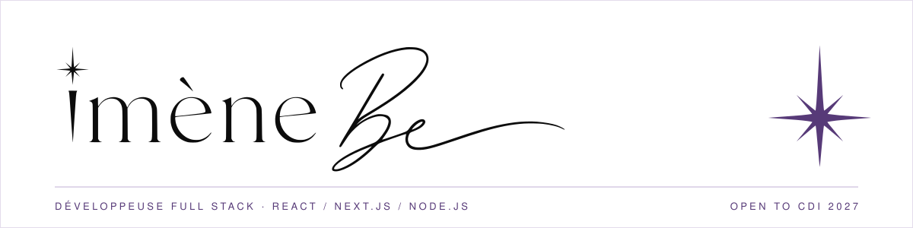
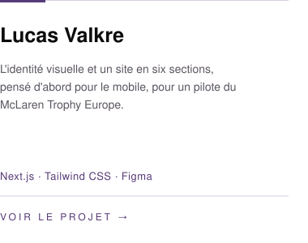
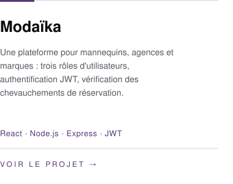
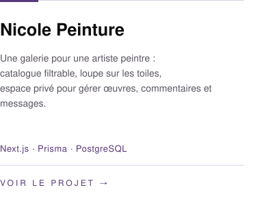
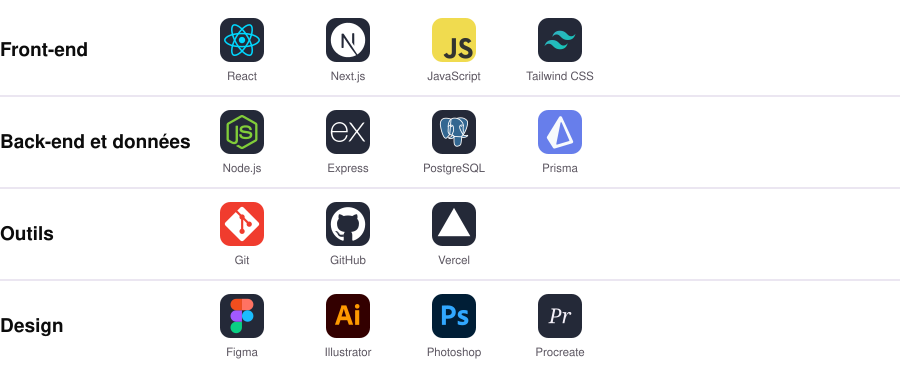
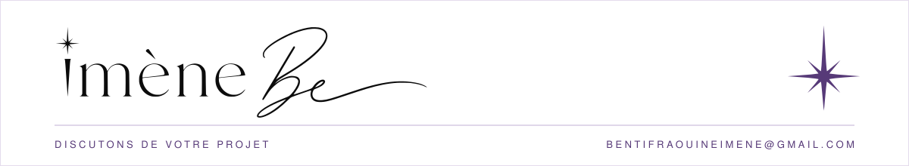

<div align="center">

<picture>
  <source media="(prefers-color-scheme: dark)" srcset="https://raw.githubusercontent.com/imene-be/imene-be/main/banner-dark.svg">
  
</picture>


<b>Développeuse Full Stack React / Next.js / Node.js</b> · Apps web du Figma à la prod · UI/UX

<i>Je crée avec sens, dessine avec intuition et développe avec exigence.</i>

<br>

<a href="https://imenebe.fr"></a>
<a href="https://www.linkedin.com/in/imenebentifraouine/"></a>
<a href="mailto:bentifraouineimene@gmail.com"></a>

<a href="https://imenebe.fr/blog">Carnet de bord</a>

</div>

<br>

## Développeuse dans l'exécution, designer dans la pensée.

Je dessine depuis l'âge de quatre ans : mangas, graphisme, peinture. L'œil est venu bien avant le code.

Aujourd'hui, je construis des applications web comme on compose une image. Chaque écran est dessiné d'abord dans Figma, pensé pour celui qui s'en sert, puis écrit en React, Next.js et Node.js jusqu'à la mise en ligne.

Mon regard d'illustratrice sait ce qu'on peut laisser de côté pour que l'essentiel demeure. Ma formation en gestion de projets informatiques cerne le besoin avant la première ligne de code.

```ts
const imene = {
  metier: "Développeuse Full Stack React / Next.js / Node.js",
  commenceAvec: "un crayon, à quatre ans",
  parcours: ["manga", "graphisme", "peinture", "code"],
  statut: "Open to CDI 2027",
  cherche: ["grands groupes", "ESN"],
  convictions: [
    "Un beau site ne suffit pas : il faut savoir quoi laisser de côté.",
    "Un résultat s'obtient en quelques prompts, le chemin reste à raconter.",
  ],
};
```

## Sélection de projets

<a href="https://lucasvalkre.com"></a>&nbsp;&nbsp;
<a href="https://lnkd.in/dvFeDM-i"></a>&nbsp;&nbsp;
<a href="https://nicolepeinture.imenebe.fr"></a>

Les autres projets (Narval, Chef Vertu, GoatUp, CineZone, TrajetIA) sont détaillés sur [imenebe.fr](https://imenebe.fr).

## Boîte à outils



## En ce moment

**Poste** : alternante développeuse Full Stack chez Tornade.io, dans une équipe agile de 4 personnes.

**Titres** : Concepteur Développeur d'Applications (RNCP niveau 6) · Master Manager de Projets Informatiques (RNCP niveau 7).

**Recherche** : **Open to CDI 2027** · Lyon, Paris ou Provence-Alpes-Côte d'Azur, mobilité possible partout en France · Grands groupes et ESN.

## Discutons de votre projet.

bentifraouineimene@gmail.com · [LinkedIn](https://www.linkedin.com/in/imenebentifraouine/) · [imenebe.fr](https://imenebe.fr)

<br>

<div align="center">

<picture>
  <source media="(prefers-color-scheme: dark)" srcset="https://raw.githubusercontent.com/imene-be/imene-be/main/footer-dark.svg">
  
</picture>

</div>
