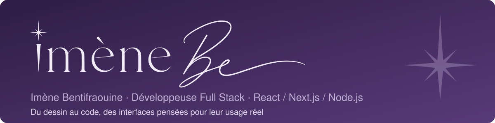

<div align="center">



<br>

<i>« La perfection est surestimée, l'originalité est reine. »</i>

<br><br>

<a href="https://imenebe.fr"></a>
<a href="https://imenebe.fr/blog"></a>
<a href="https://www.linkedin.com/in/imenebentifraouine/"></a>

</div>

<br>

## ✦ Tout a commencé avec un crayon

Je dessine depuis l'âge de quatre ans. D'abord des mangas, puis du graphisme, puis de la peinture. Un jour, j'ai voulu que mes dessins vivent : j'ai appris à coder.

Aujourd'hui, je construis des applications React / Node.js, de la maquette Figma à la mise en ligne, en pensant chaque écran pour l'usage réel de ceux qui s'en servent. Mon regard d'illustratrice m'aide à soigner chaque interface, et mon Master Manager de Projets Informatiques m'apprend à cerner le besoin avant d'écrire la première ligne de code.

```ts
const imene = {
  metier: "Développeuse Full Stack",
  commenceAvec: "un crayon, à quatre ans",
  parcours: ["manga", "graphisme", "peinture", "code"],
  statut: "Open to CDI 2027",
  cherche: ["grands groupes", "ESN"],
  convictions: [
    "Un beau site ne suffit pas : il faut savoir quoi laisser de côté.",
    "Un résultat s'obtient en quelques prompts, le chemin reste à raconter.",
  ],
};
```

## ✦ Ce que je construis

<table>
  <tr>
    <td width="33%" valign="top">
      <h3><a href="https://lucasvalkre.com">Lucas Valkre</a></h3>
      L'identité visuelle et un site en six sections, pensé d'abord pour le mobile, pour un pilote du McLaren Trophy Europe.
      <br><br>
      <sub>Next.js · Tailwind CSS · Figma</sub>
    </td>
    <td width="33%" valign="top">
      <h3><a href="https://lnkd.in/dvFeDM-i">Modaïka</a></h3>
      Une plateforme pour mannequins, agences et marques : trois rôles d'utilisateurs, authentification JWT et vérification des chevauchements de réservation.
      <br><br>
      <sub>React · Node.js · Express · JWT</sub>
    </td>
    <td width="33%" valign="top">
      <h3><a href="https://nicolepeinture.imenebe.fr">Nicole Peinture</a></h3>
      Une galerie pour une artiste peintre : catalogue filtrable, loupe sur les toiles et espace privé pour gérer œuvres, commentaires et messages.
      <br><br>
      <sub>Next.js · Prisma · PostgreSQL</sub>
    </td>
  </tr>
</table>

Les autres projets (Narval, Chef Vertu, GoatUp, CineZone, TrajetIA) sont détaillés sur **[imenebe.fr](https://imenebe.fr)**.

## ✦ Mon univers

- **Un carnet de bord « sans filtre »** : je raconte mes choix, mes doutes et ce qui a raté. [imenebe.fr/blog](https://imenebe.fr/blog)
- **Un assistant IA** sur mon portfolio, qui connaît mon parcours et mes projets.
- **Mes dessins** : mangas, illustrations et peintures, à retrouver sur mon portfolio.

## ✦ Ma boîte à outils

<p>

</p>
<p>

</p>

## ✦ En ce moment

- Alternante développeuse Full Stack chez **Tornade.io**, dans une équipe agile de 4 personnes.
- Titre Concepteur Développeur d'Applications (RNCP niveau 6), Master Manager de Projets Informatiques (RNCP niveau 7).
- **Open to CDI 2027**, de préférence à Lyon, à Paris ou en Provence-Alpes-Côte d'Azur, mobilité possible partout en France.

<br>

<div align="center">


</div>
